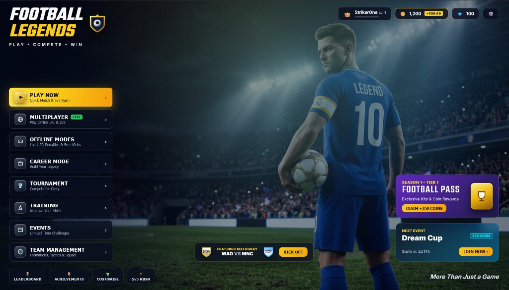

  

  

---

### 🛡️ About Me
- 🌐 **Full-Stack Web Developer**: Building responsive, high-performance web applications with **TypeScript**, **React/Vite**, **Node.js**, **Express**, **WebSockets**, and **SQLite**.
- 🎮 **3D Game Development Engineer**: Creating real-time 3D simulations and multiplayer games using **Three.js**, **Blender**, and **Unity 6 (URP / Photon Fusion 2 / PlayFab)**.
- 🔐 **Cybersecurity & Anti-Cheat**: Focused on server-authoritative game state validation, rate-limiting, input sanitization, and secure backend APIs.

---

### ⚡ Tech Stack & Arsenal

#### 🌐 Web & Backend

#### 🎮 Game Dev & 3D

#### 🔐 Cybersecurity & Networking

---

### 🏆 Featured Project: [Football Legends 3D](https://github.com/dhakarajay359-commits/football-legend)

  

- **Real-Time 3D Football Simulation** with 60Hz deterministic ball physics (Magnus curve, tackling, offsides, penalties, AI teams) and **Blender-sculpted 3D players**.
- **Authoritative Online Multiplayer** (`ws` + `node:sqlite`) with anti-cheat input validation, private room codes, 1v1/2v2 matchmaking, and reconnection.

---

### 📊 GitHub Analytics

  
  

  

