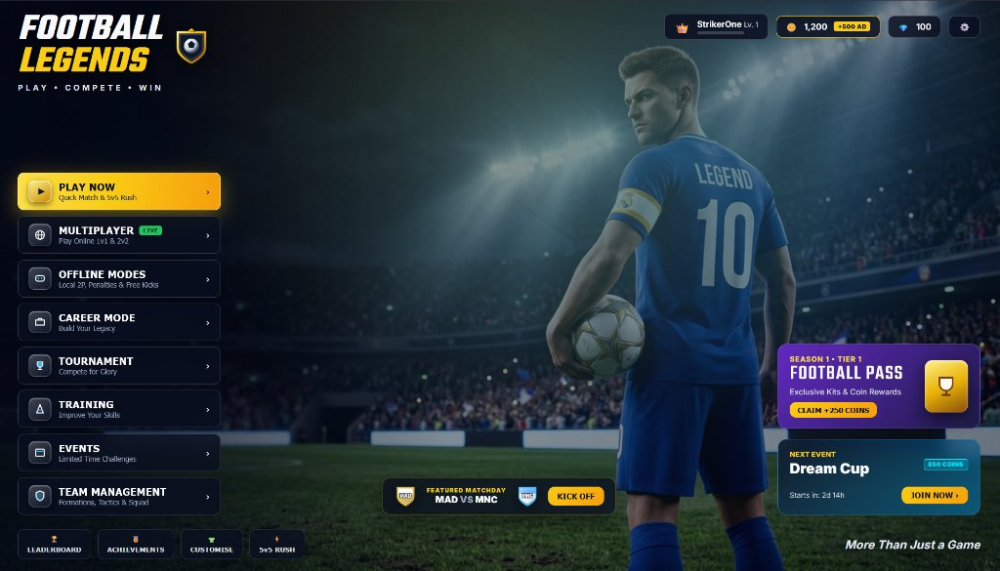

# Football Legends — 3D Football Simulation Game



### 🎥 Live Match Simulation Preview


A real-time 3D football simulation game built with **Three.js**, **TypeScript**, **Node.js**, **WebSockets**, **SQLite**, and **Blender 3D** character assets—plus a modular **Unity 6 (URP + Photon Fusion 2 + PlayFab)** project structure under `UnityFootballGame/`.

## Features
- **3D Match Engine**: 60Hz deterministic football physics (ball spin/Magnus curve, dribbling, passing, through balls, crosses, shooting, volleys, headers, tackling, offsides, fouls, cards, penalties, corners, throw-ins).
- **Game Modes**: 11v11 Quick Match, 5v5 Rush, Local 2-Player, Penalty Shootout, Free Kick Challenge, Career Mode, Knockout Tournament, Live Events, and 10 Practice & Training Drills.
- **Online Multiplayer**: Authoritative 60Hz WebSocket server supporting 1v1 Ranked/Casual, 2v2 Co-op, Private Rooms with Invite Links, and Reconnection.
- **Camera Modes**: Broadcast, Drone (Whole Ground), Dynamic 3rd-Person, Tele, and Pro Camera.
- **CrazyGames SDK v3 Ready**: Integrated midgame & rewarded ad hooks.

## Getting Started
```bash
npm install
npm run dev
```
Open `http://localhost:5173` (or run `npm run build && npm start` and open `http://localhost:3001`).
